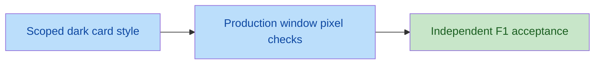

# Verification Checklist

## Settings and Touchscreen
- [x] A full-width MANUAL OUTPUT TESTING section is below all existing Settings content and lists exactly ACU 1, ACU 2, Water Alarm, Smoke Alarm, Temperature Alarm, and Humidity Alarm. Evidence: V1 T22 plus inspection of `hmi/pages/settings.py:286-328` and `hmi/output_test.py:8-15`.
- [x] All six toggles, Start Test/End Test, status/error text, and scrolling controls are reachable and readable at 800x480; interactive targets and scroll handles are at least 48x48 pixels with no horizontal scrolling. Evidence: V7 fresh T22/T28 and independent visual inspection resolve F1. Production-font composed-window rendering passes 90 title/warning/banner/name/state samples in six scenarios, minimum contrast 6.45:1 on `#2d343e`. Retained geometry evidence: Start/End 343x66, six toggles 147x66, command labels 266x66, viewport 730x178, scroll handle 48x48, horizontal range 0; all reachable. Restoring/unconfirmed/offline sample banners have actual/required height 16px at width 710px. The full card is scrollable, not simultaneously visible in one viewport.
- [x] Opening Settings does not change outputs; toggles require an accepted test session, and warning cancellation creates no session. Evidence: V1 T22 asserts no requests on open/cancel and disables all six toggles before acceptance; backend V2 snapshot test asserts no writes on start.
- [x] Start confirmation explicitly warns about real relay activation, temporary automatic override, restart-protection bypass, and disconnected ACUs/dummy loads. Evidence: V1 T22 inspects the actual confirmation message for all six warning terms.
- [x] Pending, rejected, failed, malformed, offline, and stale-response cases never falsely show successful commands or restoration. Evidence: fresh V3 T22-T25 assertion inspection and execution covers non-optimistic labels, 422, malformed/timeout responses, late command/end replies, and reversed/pre-mutation polls; V4 actual disconnect keeps UNKNOWN/unconfirmed until fresh backend status.
- [x] Existing effective settings, dirty edits, Save/Revert behavior outside testing, and acuPilot branding remain intact; Save is visibly unavailable during testing. Evidence: fresh V3 T14/T18/T19/T22 validate branding, authoritative settings, pending snapshot safety, Save/Revert and preserved edits across testing; `hmi/pages/settings.py` Save guard and retained models inspected.

## Session and Output Behavior
- [x] Session start atomically snapshots all six original commands without changing them or the operating mode; a second owner cannot replace the snapshot. Evidence: V2 `test_all_64_snapshots_restore_and_each_channel_is_independent` in AUTO/MANUAL/PAUSE and `test_concurrent_start_has_exactly_one_owner` (16 HTTP starts: one 200, fifteen 409); engine RLock inspection.
- [x] Each of the six outputs can independently turn ON/OFF through configured named GPIO writes; input and DHT pins are never written. Evidence: V2 independence and configured-pin/polarity tests exercise both values on each channel, preserve input pin levels, exclude DHT GPIO4 from output devices, and verify overridden ACU20/21 rather than legacy17/27.
- [x] Test commands and restoration deliberately bypass ACU restart delay, while ordinary ACU commands retain protection outside testing. Evidence: V2 `test_restart_bypass_real_transition_times_and_repeated_writes` verifies direct OFF/ON/restoration, real transition timestamps, and subsequent ordinary-command restart rejection.
- [x] Automatic cooling/alarm writes cannot undo tests; sensor freshness and sensor-derived alarm reporting continue without fabricated alarms. Evidence: V2 `test_ticks_suppress_all_writes_but_qualify_clear_and_stale_alarms` asserts zero tick writes, qualified/cleared smoke and temperature alarms, SENSOR_STALE, no fabricated water alarm, and post-end automatic writes.
- [x] Mode, ordinary ACU, and runtime settings mutations are rejected during testing; strict boolean/channel/extra-field/session validation rejects invalid requests without output changes. Evidence: V2 conflict and strict-payload tests assert 409/422, unchanged settings/config, zero writes and no lease renewal for bad requests.
- [x] API/status expose authoritative test state, original states, lease remaining, and restoration errors, but general status never exposes the owner identifier. Evidence: V2 `test_exact_contract_empty_body_and_authoritative_mutation_replies`, failed-write/restore HTTP tests, and `assert_status` check exact additive keys and absence of session IDs from general status.
- [x] All 64 original six-output combinations restore exactly on healthy session end; write cache updates occur only after successful writes. Evidence: V2 64 combinations in each mode and each supported alarm polarity; every-channel failure tests assert unchanged failed-write caches/timestamps and independent remaining restore attempts.

## Exit and Recovery
- [x] End Test restores the pre-test snapshot before releasing ownership; subsequent normal control resumes in the preserved mode and may apply current conditions. Evidence: V4 actual HMI end/navigation acknowledgement contains all six original commands, followed by AUTO tick clearing water/temperature/ACU2 according to changed inputs; explicit End Test remains on Settings. Engine lock/release order inspected.
- [x] Every navigation path away from Settings awaits restoration asynchronously; repeated clicks, in-flight commands, old replies, and repeated end requests cannot reactivate or overwrite a newer session. Evidence: fresh V3 T23 covers all six destinations, first-click retention, pending start/output drain and late replies; V4 live navigation waits for restored acknowledgement and old-owner end leaves newer owner/state unchanged; fresh backend retry/lock tests pass.
- [x] Leaving Settings without testing changes no outputs, and re-entry/new tests capture fresh snapshots. Evidence: fresh V3 T23 no-test departure issues no mutations; V4 start cancellation writes nothing and re-entry captures changed current snapshot with distinct owner.
- [x] HMI renews the 10-second backend lease every 2 seconds only while testing on Settings and stops renewal on end, departure, or disconnect. Evidence: fresh V3 T24 interval/active assertions and T23/T26 stop assertions; controller `_refresh`/heartbeat guards inspected; V4 actual disconnect permits lease expiry rather than renewal.
- [x] Client crash/disconnect recovers through monotonic lease expiry by the next configured control tick; reconnect reconciles status without replaying old toggles. Evidence: V4 real running backend tick=0.1s, actual HMI disconnected then separately SIGKILLed: restore began 0.0814s/0.0760s after monotonic deadline; reconnect fresh status completes pending navigation without replay. Fresh backend fake-clock test covers exact boundary and expiry-tick snapshot preservation.
- [x] Unconfirmed navigation restoration leaves Settings responsive with testing disabled and a visible error; navigation completes only after authoritative confirmation. Evidence: V4 disconnect leaves Settings UNKNOWN/unconfirmed with renewals stopped, 198 Qt timer callbacks during recovery, and pending navigation completes only on restored status; fresh V3 T24/T26 exercise timeout, malformed and failed/fatal outcomes.
- [x] Graceful HMI close/SIGINT/SIGTERM attempts bounded session end before network teardown; abrupt exit remains covered by the backend lease. Evidence: V4 real window close receives restoration before client teardown in 0.0815s; fresh V3 T26 drains output/ack before shutdown and bounds lost reply at 2500ms while responsive; T27 actual subprocess SIGINT/SIGTERM sends end; V4 actual SIGKILL falls back to lease.
- [x] Partial restoration failure still attempts all other saved outputs, reports failure, and invokes fatal all-six-OFF without falsely claiming Restored. Evidence: V2 each restore channel fails on explicit end and expiry; exact call order is six restores then six OFF attempts; HTTP returns 500 including retries. V1 T24 keeps failed/fatal restoration unconfirmed and navigation blocked.
- [x] Backend shutdown/fatal error cancels the session and attempts all-six-OFF; pre-test ON states are never restored afterward. Evidence: V2 lifecycle test asserts six OFF calls, rejects subsequent mutations, and suppresses ticks; `test_sigint_sigterm_fail_off_and_join` exercises actual process signals.
- [x] Session state is never persisted to configuration or reused after backend restart. Evidence: V2 conflict/no-persistence test constructs a fresh Engine with inactive test; HTTP exact-contract test confirms config remains `{}`; session fields exist only on Engine inspection.

## Regression and Evidence
- [x] Full backend tests and complete HMI offscreen tests pass with recorded commands, counts, and results. Evidence: final independent V7 passes HMI 28/28 and backend 88/88; both stale GPIO default expectations were corrected to existing 9/16 without wiring changes.
- [x] Local backend/HMI simulation integration verifies restoration, normal-control resumption, API conflicts, and lease recovery. Evidence: V4 external verifier fresh run, seven scenarios passed against actual uvicorn/create_app/Engine workers and Qt BackendClient/window, no canned API responses.
- [x] README explains direct-test hazards, dummy-load commissioning, lease recovery, command-only status, and shutdown/power-loss limitations. Evidence: independent inspection of `README.md:101-133` covers all six outputs, bypass/override warning, dummy loads, end/navigation restoration then normal ticks, 10s/2s lease, bounded graceful end, UNKNOWN/unconfirmed, runtime-only snapshots, fatal/shutdown OFF and power/electrical limitations; physical commissioning explicitly deferred at lines 93-99.
- [x] Independent delegated verification records software evidence separately from physical hardware validation; unrelated user changes remain intact. Evidence: independent verifier continuation edited only checklist/task acceptance, ran external `/tmp` scripts/inline processes with temporary config, and preserved all existing worktree changes. No application fixes or README changes; `git diff --check` passes. Physical commissioning remains deferred.

## Findings Requiring Fix
- [x] F1 (P1), independently resolved: `hmi/pages/settings.py` preserves `settings_output_test` and applies scoped `BG_CARD`/`BORDER` styling matching the established StatusCard appearance. V7 independently inspects the fix and T28, passes active/inactive/offline plus rejected/restoring/restored rendered contrast checks at 800x480, and confirms that removing only this style in memory makes the regression detect the original light background. No application edits by final verifier.

## Physical Validation Limits
Physical relay operation, electrical polarity, real touchscreen use, and power-loss behavior require on-device commissioning with dummy loads/disconnected ACUs. They are not acceptance claims made by simulation or offscreen tests, and their absence must be disclosed in the completion evidence.

## Independent Evidence (2026-10-11)
- V1: `QT_QPA_PLATFORM=offscreen /home/rheg/App/.venv/bin/python -B -m hmi.tests.smoke`, cwd `/home/rheg/App`: 27 passed, 0 failed, 27 total. Independently run; existing assertion bodies inspected, not accepted solely from task evidence.
- V2: `/home/rheg/App/.venv/bin/python -B -m unittest discover -s backend/tests -v`, cwd `/home/rheg/App`: 88 tests in 13.484s, OK. Includes 10 session tests, 9 live HTTP session/API tests, regression and signal tests. GPIO mock deprecation warning is non-failing.
- V3 (fresh after interruption): `/home/rheg/App/.venv/bin/python -B -m unittest discover -s backend/tests -v`, cwd `/home/rheg/App`: 88 tests in 13.376s, OK; `env QT_QPA_PLATFORM=offscreen /home/rheg/App/.venv/bin/python -B -m hmi.tests.smoke`, same cwd: 27 passed, 0 failed. Assertion bodies and production lifecycle/client code independently inspected.
- V4 (fresh after interruption): `/home/rheg/App/.venv/bin/python -B /tmp/manual_output_independent_verify.py`, cwd `/tmp`: seven live simulation integration scenarios passed. Actual backend workers and Qt HTTP client; temp config outside App, no persistence; mixed snapshot `{acu1: ON, acu2: ON, water: ON, smoke: OFF, temperature: ON, humidity: OFF}` restored in end acknowledgement before AUTO resumes to only ACU1 ON. Disconnect/SIGKILL lateness 0.0814s/0.0760s with configured 0.1s tick; responsive GUI 198 timer callbacks; actual graceful close 0.0815s.
- V5: external inline `env QT_QPA_PLATFORM=offscreen /home/rheg/App/.venv/bin/python -B -c ...`, cwd `/tmp`, using `set_app_fonts(app)` (actual 10pt production font plus QSS), `Harness` window active state and actual Qt painting: geometry/scroll reachability and sample banner height assertions pass, but pixel sampling and visual inspection identify F1. Screenshot `/tmp/manual-output-independent-active-800x480.png` shows enabled toggles alongside nearly invisible names/command states; original live integration screenshot `/tmp/manual-output-independent-800x480.png` shows same defect inactive. Contrast calculated from actual foreground/background is 1.035:1. Existing smoke suite checks geometry, not background/contrast.
- V6: completed external inline `env QT_QPA_PLATFORM=offscreen /home/rheg/App/.venv/bin/python -B -c ...`, cwd `/tmp`; full captured command/results in `/tmp/trae-agent-toolhost-1000/jobs/job-36b866ba6e474351b01257058f4e5a6c/output.log` and tool history. Actual `LiveServer(create_app(engine))`, simulated IO, production-font `CoolShiftHMI`/Qt HTTP client: all 64 snapshots in each of AUTO/MANUAL/PAUSE (192 sessions), invert every channel then End Test, assert end acknowledgement and engine outputs equal original snapshot with preserved mode and released session, then invoke subsequent real normal tick. Worker ticks temporarily suppressed for deterministic exact-ack observation; V4 separately verifies uninterrupted running workers and real-time recovery. All assertions passed and process exited. Production pixel sampling independently repeats F1, screenshot `/tmp/manual-output-independent-production-800x480.png`; banner and target reachability assertions pass.
- V7 (final independent F1 acceptance): inspected current spec/tasks/checklist, scoped Settings QSS, production theme/fonts, T28 pixel assertions and suite registration. Fresh `env QT_QPA_PLATFORM=offscreen .venv/bin/python -B -m hmi.tests.smoke`, cwd `/home/rheg/App`: 28 passed, 0 failed. Fresh `.venv/bin/python -B -m unittest discover -s backend/tests -v`, same cwd: 88 tests in 12.664s, OK; gpiozero deprecation warning non-failing. T22 verifies reachability/48px targets and T28 verifies 90 composed-window samples, minimum 6.45:1 across inactive/active/rejected/restoring/restored/offline.
- V7 negative control: independent `env QT_QPA_PLATFORM=offscreen .venv/bin/python -B -c ...`, cwd `/home/rheg/App`, patches only `StatusCard.setStyleSheet` in memory to omit `QFrame#settings_output_test`; T28 fails as expected with `('inactive', 'MANUAL OUTPUT TESTING', (239, 239, 239))`. Removing that patch and rerunning T28 passes all 90 samples at minimum 6.45:1. No source mutation. Independently viewed `/tmp/manual-output-task5a-active.png`, `/tmp/manual-output-task5a-inactive.png`, `/tmp/manual-output-task5a-offline.png`; names, commands, warning and banners are readable. These are full scroll-card captures from the 800x480 HMI.
- V7 status audit: every software checkpoint has genuine retained or fresh evidence; V6 captured trace independently rechecked for 64 successful live HMI/HTTP sessions in each mode (192 total), not rerun or attributed to this final pass. V4 remains the uninterrupted-worker recovery evidence. Stale GPIO test assertions now match existing fallback 9/16, retain meaningful copy isolation, and preserve explicitly installed 17/27; no wiring/configuration changes by this verifier. `git diff --check` passes. Only checklist/tasks acceptance edited with `apply_patch`; existing edits preserved. All software acceptance items and Task 5 are complete, with no remaining findings; physical commissioning remains deferred.

- GPIO test rationale independently checked: prior default expectations 17/27 were stale against preserved fallback `backend/config.py` 9/16. Copy-isolation test now mutates returned ACU1 default to 17 and asserts source remains 9, retaining a meaningful isolation test. Explicit installed `config.json` 17/27 overrides remain unchanged and covered by `test_saved_installation_loads_unchanged`; README distinguishes installed overrides from fallback defaults. V3 confirms 88/88 after separate agent's correction, without changing wiring/configuration here.
- Verification owns checklist/task acceptance and external test scripts only; no application fixes or README edits. Existing dirty worktree is preserved. Physical commissioning is deferred and no mock/offscreen result proves electrical relay operation.
